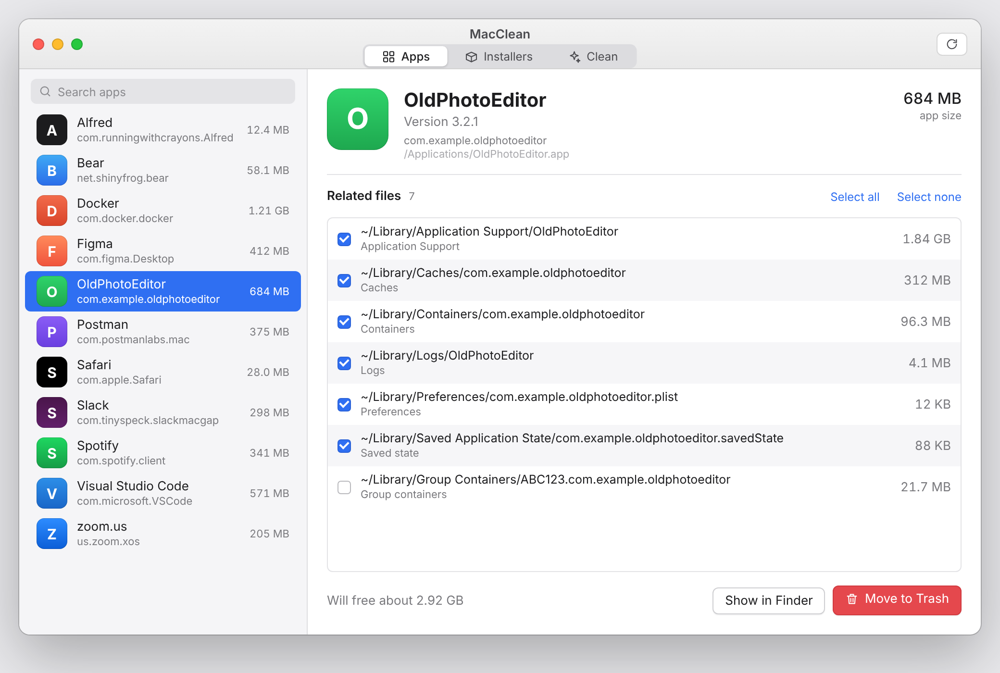
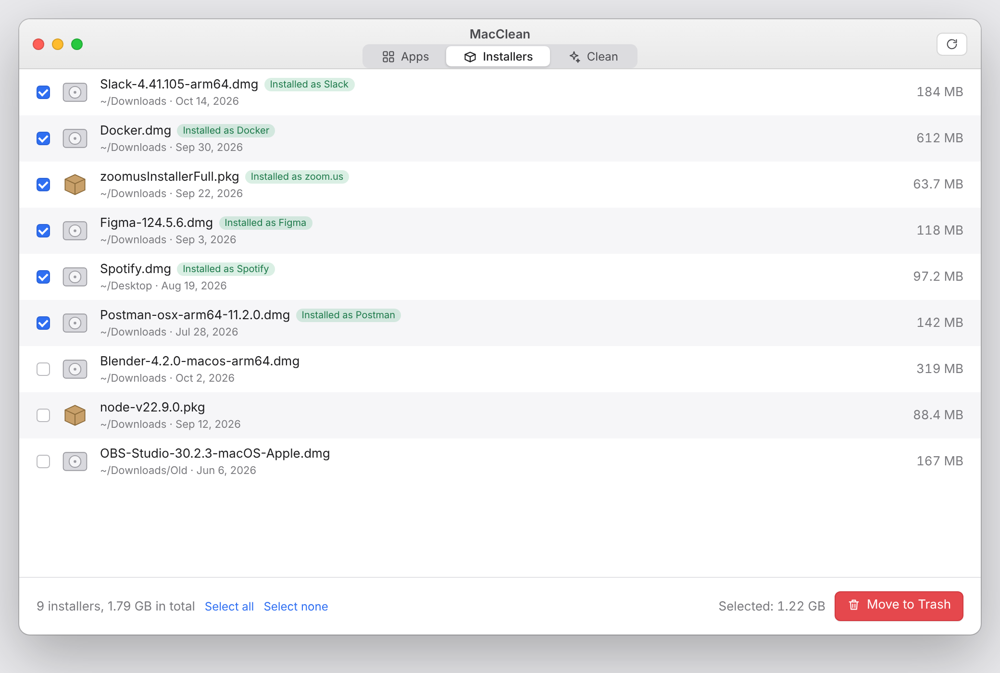
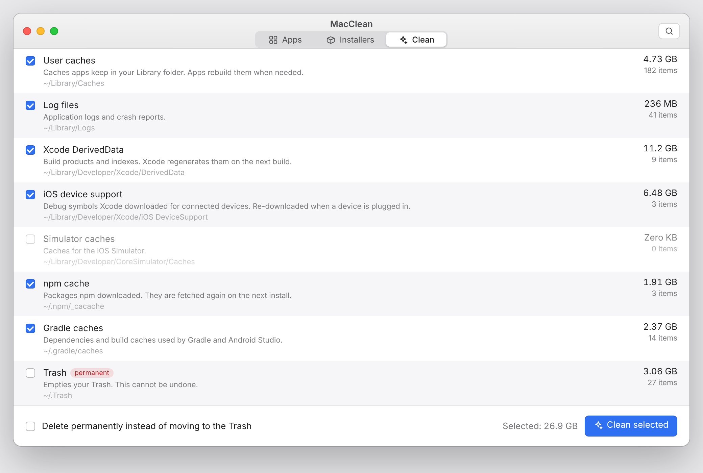
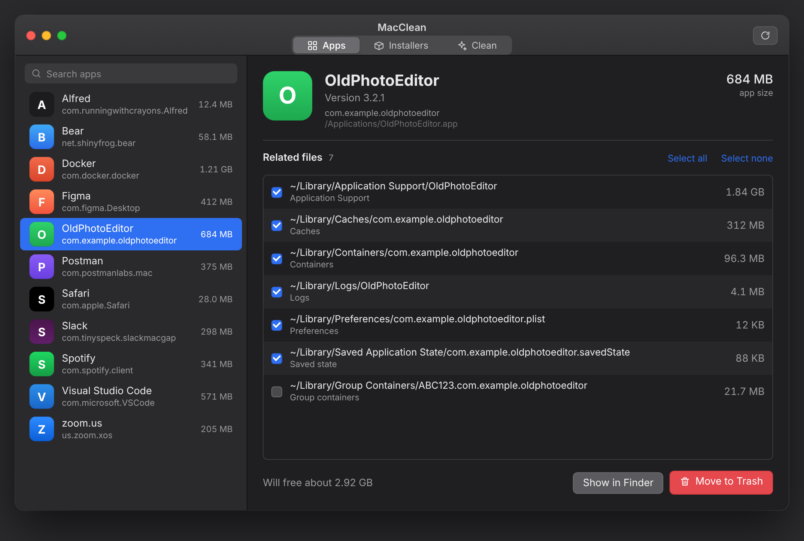
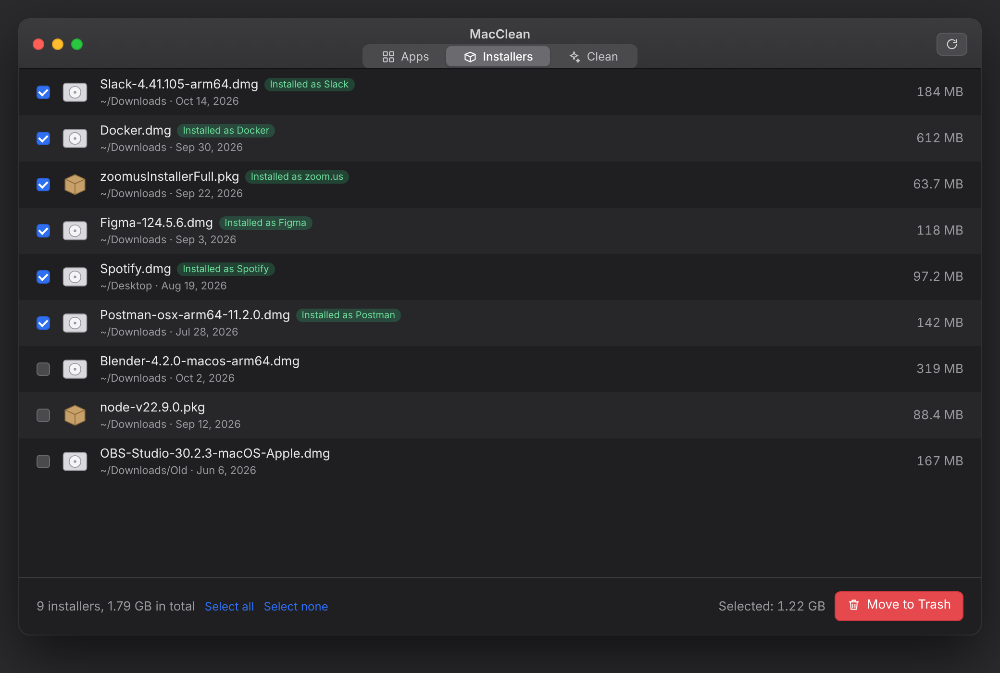

# MacClean

A small, open-source macOS app that uninstalls apps properly and clears out junk.

Most apps leave caches, preferences, logs and support files behind when you drag them to the Trash. MacClean finds those leftovers and removes them together with the app, and it also clears the usual space hogs: caches, logs, Xcode build data, package manager caches and the Trash.

No ads, no subscriptions, no background helpers. One window, two tabs.

<p align="center">
  
</p>

## Screenshots

**Apps tab**: pick an app, review what it left behind, move it all to the Trash.



**Installers tab**: old disk images and packages, with the ones already installed marked.



**Clean tab**: measure the junk, tick what to clear, clean.



**Dark mode**: MacClean follows your system appearance.





*These are rendered previews of the interface (see `docs/previews`), not captures from a running Mac. Real screenshots are welcome in a pull request.*

## Features

**Apps tab**
- Lists every app in `/Applications` and `~/Applications` with its size.
- Select an app to see what it left in `~/Library` (Application Support, Caches, Preferences, Logs, Saved State, Containers, Group Containers, WebKit data, cookies, launch agents, crash reports).
- Tick what you want to remove and press **Move to Trash**. Nothing is deleted permanently, so you can always put things back.
- Apps made by Apple are shown but locked, because macOS protects them.
- For apps that need an administrator password, MacClean asks Finder to do the move so macOS can prompt you.

**Installers tab**
- Finds the `.dmg`, `.pkg` and `.xip` files sitting in your Downloads and Desktop folders (up to three folders deep).
- Flags each one whose app is already installed, for example `Slack-4.41.dmg` when Slack is in your Applications folder, and pre-selects those.
- Move the selected installers to the Trash in one click.

**Clean tab**
- Measures each junk category and pre-selects the safe ones:
  user caches, log files, Xcode DerivedData, iOS device support files, simulator caches, the npm cache, Gradle caches and the Trash.
- Items go to the Trash by default. Tick **Delete permanently** to skip it.
- Emptying the Trash is always permanent and is never pre-selected.

## Install

MacClean needs macOS 13 Ventura or newer.

**Download**: grab `MacClean.zip` from the [Releases](../../releases) page (or from the latest run on the Actions tab), unzip it and drag `MacClean.app` to your Applications folder.

The app is not notarized, so the first time you open it right-click (or Control-click) `MacClean.app` and choose **Open**, then confirm.

**Build from source** (needs Xcode or the Command Line Tools):

```bash
git clone https://github.com/Temidayomichael/macclean.git
cd macclean
scripts/bundle.sh          # creates build/MacClean.app
open build/MacClean.app
```

For a quick run without building a bundle:

```bash
swift run
```

You can also open `Package.swift` in Xcode and press Run.

## How it works

- Everything is plain Swift and SwiftUI, with no third-party dependencies.
- Installers are matched to apps by name: the file name is split into words and compared with each installed app's name, so `Postman-osx-11.2.dmg` matches Postman but `search-results.dmg` does not match Arc.
- Leftovers are matched by the app's bundle identifier (for example `com.vendor.app`, plus helpers like `com.vendor.app.helper`) and, as a fallback, by its exact name. Names shorter than three characters are ignored to avoid false matches.
- Sizes are the allocated size on disk, and symbolic links are never followed.
- Removal uses `FileManager.trashItem`, the same thing Finder does. Permanent deletion uses `removeItem`.
- Nothing runs as root. If a file can't be removed, MacClean tells you which one and why.

The README previews are rendered from the HTML in `docs/previews` with `node docs/previews/render.js docs` (needs Playwright). To replace them with real screenshots, run the app, press Cmd-Shift-4 then Space, click the window, and save the files over `docs/screenshot-apps.png` and `docs/screenshot-clean.png`.

The app icon is drawn by `scripts/make_icon.py` (needs Pillow), which writes `Resources/AppIcon.png` and `Resources/AppIcon.icns`.

## Safety notes

- Quit an app before uninstalling it, otherwise its running processes may recreate files.
- Clearing caches means apps will be a little slower the first time you open them again.
- Check the leftover list before confirming. Group containers can be shared by several apps from the same vendor.

## Contributing

Issues and pull requests are welcome. Good first contributions:

- More junk categories (Homebrew downloads, Docker images, Mail attachments, old iOS backups).
- Mounting a disk image to read the real app name inside it, instead of guessing from the file name.
- Finding orphaned support files for apps that are already gone.
- Localization.

## License

[MIT](LICENSE)
